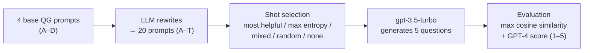

# Prompt Informativeness Optimization for Conditional Question Generation

[English](README.md) | [中文](README.zh-CN.md)

Code and data for the paper **"Prompt Informativeness Optimization for Conditional Question Generation"** (Diyang Xie, China Jiliang University). [📄 Paper (PDF)](paper/Prompt_Informativeness_Optimization_for_Conditional_Question_Generation.pdf)

**TL;DR**: In question generation, an LLM receives an *answer* and has to recover the *original question*. Once a prompt already states the task clearly, rewording it further helps very little. This project improves question quality by choosing which **few-shot demonstrations** to add to the prompt. It compares three shot-selection strategies (most similar, most diverse, and a mix of the two) across 20 prompts on two datasets.

## Highlights

- **3 demonstration construction methods**: *Most Helpful Shots* (similarity), *Maximum Entropy Shots* (diversity) and *Mixed* (similarity, then diversity), compared against *Random* shots and *No shots*.
- **A 20-prompt candidate set**: 4 question-generation prompts from prior work, plus 16 LLM-generated rewrites of them.
- **Two evaluations**: maximum cosine similarity to the reference question, and GPT-4 scoring on a 1–5 rubric.
- **Main findings**
  - With 5 shots, *Maximum Entropy* shots give the best average cosine similarity across all 20 prompts.
  - The best configuration improves cosine similarity by about **+0.03** over the plain baseline prompt (0.8003).
  - The **number of shots has a sweet spot around 5–7**. Using more shots makes results worse again.
  - Prompts that ask for "complex / intricate / sophisticated" questions consistently do worse, because they push the model away from the original question.

## Method



### 1. Prompt candidate set ([`prompts/prompts.json`](prompts/prompts.json))

The starting point is the four question-generation prompts from [Amyeen, 2023](https://arxiv.org/abs/2310.18867):

| ID | Prompt |
|---|---|
| A | Generate 5 questions from the given text. *(baseline: simplest, imitates an ordinary user)* |
| B | Generate 5 complex questions derived from the text. |
| C | Generate 5 questions from the text; make sure the questions can be answered. |
| D | Generate 5 questions from the text; answer the question in the text; if the question is answered in the context, output 5 questions. |

An LLM rewrites each base prompt four times (*Adaptation, Variation, Modification, Twist*). The rewrites keep the meaning but change wording and syntax, which gives prompts E–T ([`qg/expand_prompts.py`](qg/expand_prompts.py)). Each prompt asks for 5 questions, and the best-matching one counts toward the score.

### 2. Demonstration (shot) construction ([`qg/shots.py`](qg/shots.py))

Each candidate shot is a (question, answer) pair. Answers are embedded with spaCy word vectors and compared with cosine similarity.

| Method | How the k shots are chosen | Intuition |
|---|---|---|
| **Most Helpful** | The k pool answers **most similar** to the input answer | Similar answers "leak" the target question pattern to the model |
| **Maximum Entropy** | Greedy: the answer least similar to the input, then the answer least similar to the previous shot, and so on | Cover as many situations as possible, without redundancy |
| **Mixed** | Take the 20 most similar answers as candidates, then greedily pick the candidates with the lowest combined similarity to the input and to the shots already chosen | Relevant *and* diverse |
| Random | k random pool answers | Control |
| No shots | Zero-shot | Control |

### 3. Evaluation

- **Cosine similarity** ([`qg/eval_cosine.py`](qg/eval_cosine.py)): for each input, compute the maximum similarity between the reference question and the 5 generated questions. These maxima are averaged over all inputs, and then over the two datasets.
- **GPT-4 scoring** ([`qg/eval_gpt4.py`](qg/eval_gpt4.py)): GPT-4 rates each generated question against the reference question on a 1–5 rubric. The rubric runs from 1 = "completely different meaning" to 5 = "exactly the same meaning". The best of the 5 scores is kept for each input.

### 4. Data ([`qg/prepare_data.py`](qg/prepare_data.py))

| Dataset | Size | Characteristic | Cleaning |
|---|---|---|---|
| [TruthfulQA](https://huggingface.co/datasets/truthful_qa) | 817 | long questions, short answers | Only the `generation` part is used. `multiple_choice` is dropped because its answers contain several options. |
| [Alpaca-cleaned](https://huggingface.co/datasets/yahma/alpaca-cleaned) | 51,760 | short questions, long answers | Rows with a non-empty `input` are dropped, since the original question can't be recovered from the answer alone. |

From each dataset, 50 QA pairs are randomly sampled as model inputs. Each pair is then checked by hand to confirm that its answer can be traced back to the question.

## Results (as reported in the paper)

The raw tables are in [`results/paper/`](results/paper/).

### Cosine similarity: average over the 20 prompts

| Method | 2 shots | 5 shots |
|---|---|---|
| Most Helpful | 0.7977 | 0.8109 |
| **Maximum Entropy** | 0.7932 | **0.8170** |
| Mixed | 0.7871 | 0.7904 |
| Random | 0.8052 | 0.7851 |
| No shots | 0.7914 | – |

Baseline (Prompt-A, no shots): **0.8003**.

### Cosine similarity: best configurations

| Rank | Configuration | Cosine |
|---|---|---|
| 1 | Prompt-P + Max Entropy (5 shots) | 0.8334 |
| 2 | Prompt-D + Most Helpful (5 shots) | 0.8315 |
| 3 | Prompt-F + Max Entropy (5 shots) | 0.8312 |
| 4 | Prompt-M + Max Entropy (5 shots) | 0.8306 |
| 5 | Prompt-N + Max Entropy (5 shots) | 0.8303 |

### GPT-4 score: best prompt under each method

| Method | 2 shots | 5 shots |
|---|---|---|
| Most Helpful | 4.38 | 4.49 |
| **Maximum Entropy** | 4.375 | **4.50** |
| Mixed | 4.465 | 4.44 |
| Random | 4.42 | 4.41 |
| No shots | 4.365 | – |

### Effect of the number of shots (Prompt-M + Maximum Entropy)

| Shots | 1 | 2 | 3 | 4 | 5 | 6 | 7 | 8 | 9 | 10 |
|---|---|---|---|---|---|---|---|---|---|---|
| Cosine – TruthfulQA | 0.7941 | 0.8093 | 0.8245 | 0.8284 | 0.8235 | 0.8246 | **0.8305** | 0.8235 | 0.7917 | 0.8022 |
| Cosine – Alpaca-cleaned | 0.7722 | 0.8040 | 0.7901 | 0.7858 | 0.8112 | **0.8314** | 0.8081 | 0.8120 | 0.8176 | 0.7922 |
| GPT-4 – TruthfulQA | 4.34 | 4.29 | 4.36 | 4.41 | **4.46** | 4.44 | 4.39 | 4.34 | 4.36 | 4.29 |
| GPT-4 – Alpaca-cleaned | 4.28 | 4.29 | 4.22 | 4.34 | **4.51** | 4.39 | 4.17 | 4.43 | 4.40 | 4.34 |

Quality first rises, peaks at about 5–7 shots, and then declines. To plot these curves, run `python -m qg.plot_shots`.

## Repository structure

`qg` stands for **Q**uestion **G**eneration; it is the project's Python package.

```
.
├── paper/                      # the paper (PDF)
├── prompts/prompts.json        # the 20 candidate prompts (A–T)
├── qg/
│   ├── config.py               # paths, model names, defaults
│   ├── prepare_data.py         # download, clean and sample the datasets
│   ├── expand_prompts.py       # LLM rewriting of prompts A–D into E–T
│   ├── embeddings.py           # spaCy embeddings + cosine similarity
│   ├── shots.py                # most helpful / max entropy / mixed / random shots
│   ├── prompting.py            # build model input, parse generated questions
│   ├── llm.py                  # OpenAI chat wrapper with retries
│   ├── generate.py             # run question generation (resumable)
│   ├── eval_cosine.py          # evaluation 1: max cosine similarity
│   ├── eval_gpt4.py            # evaluation 2: GPT-4 rubric scoring
│   ├── summarize.py            # aggregate scores into the paper's tables
│   └── plot_shots.py           # shot-count curves
├── results/paper/              # numbers reported in the paper (CSV)
├── requirements.txt
└── .env.example
```

## Quickstart

Requires Python 3.10+.

```bash
pip install -r requirements.txt
python -m spacy download en_core_web_lg
cp .env.example .env            # then put your OpenAI key in .env, or export OPENAI_API_KEY
```

```bash
# 1. Data: writes data/{truthfulqa,alpaca}_{eval,pool}.jsonl
python -m qg.prepare_data

# 2. Main experiment: 20 prompts x 4 methods x {2, 5} shots, plus no shots
python -m qg.generate --methods most_helpful max_entropy mixed random --shots 2 5
python -m qg.generate --methods none

# 3. Shot-count ablation: Prompt-M + max entropy with 1–10 shots
python -m qg.generate --prompts M --methods max_entropy --shots 1 2 3 4 5 6 7 8 9 10

# 4. Evaluate and summarize
python -m qg.eval_cosine
python -m qg.eval_gpt4
python -m qg.summarize
python -m qg.plot_shots --from-outputs
```

Generation and GPT-4 scoring append to `outputs/` and skip finished items, so an interrupted run can be resumed.

> **Cost note**: the full grid is 2 datasets × 50 inputs × 20 prompts × 9 configurations = 18,000 generation calls, plus the same number of GPT-4 judge calls. Use `--prompts` and `--methods` to run a subset first.

## Limitations

- Each dataset contributes only 50 inputs, and every configuration was run once. Many differences between methods are small (≤ 0.03 cosine), so they should be read as trends rather than statistically significant gaps.
- Only `gpt-3.5-turbo` was used as the generator, and the embeddings are spaCy word-vector averages.
- "Maximum entropy" is a greedy diversity heuristic. No entropy is actually computed.
- GPT-4 scores were not calibrated against human judgments.

## Citation

```bibtex
@misc{xie2024prompt,
  title  = {Prompt Informativeness Optimization for Conditional Question Generation},
  author = {Xie, Diyang},
  year   = {2024},
  note   = {China Jiliang University}
}
```

## References

- R. Amyeen. *Prompt-Engineering and Transformer-based Question Generation and Evaluation.* arXiv:2310.18867, 2023.
- S. Lin, J. Hilton, O. Evans. *TruthfulQA: Measuring How Models Mimic Human Falsehoods.* arXiv:2109.07958, 2022.
- R. Taori et al. *Stanford Alpaca: An Instruction-following LLaMA model.* 2023.
- J. White et al. *A Prompt Pattern Catalog to Enhance Prompt Engineering with ChatGPT.* arXiv:2302.11382, 2023.

## License

[MIT](LICENSE)
